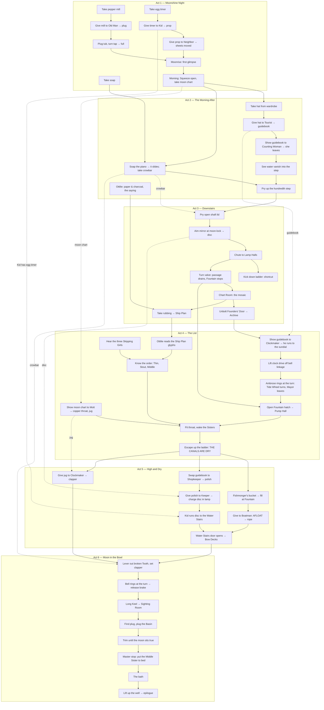

# Moonshine — Game Design Overview

This document sets the game's structure: the areas, how they connect, what is gated by what, and the order puzzles must be solved in. The story behind it is in [../story-bible.md](../story-bible.md). The first slice is specified build-ready in [01-opening.md](01-opening.md). Later slices get their own build-ready documents (`02-…`, `03-…`) when we reach them. Past the opening, this document is deliberately high-level: it fixes the *shape* of each puzzle and leaves room for details to be decided in the slice documents.

## Target

- **Length:** 2½–3½ hours for a first-time player (Act 1: 8–12 min, Act 2: 30–40, Act 3: 25–35, Act 4: 35–50, Act 5: 30–45, Act 6: 10–15).
- **Size:** about 35 surface screens and 17 underground screens (one screen is 16×14 tiles), 17 NPCs, about 25 inventory items.

## Design rules

These apply to every slice.

1. **One interact button, context-driven.** Interact (Z / Space / Enter, or click/tap the target) does the one sensible thing for that object in its current state: talk, examine, take, or operate. Each object's script decides what that is. There is no verb menu.
2. **Items are used by choosing them, then choosing a target.** Open the inventory (X / Escape / the on-screen button), pick an item, then interact with a target. Giving and showing to NPCs works the same way; the script decides whether the NPC keeps the item (give) or hands it back (show). Wrong combinations get a specific line in Cheryl's voice where it's funny, and a generic one otherwise.
3. **First look, then repeat look.** Every object has a first description and a short repeat. Descriptions change when the world changes.
4. **No death, no fail states, no dead ends.** An item that's needed later is never consumed early. If a player could give it away too soon, the recipient declines until the right moment ("My window is complete.").
5. **Always two things to do.** At almost every point, the player has at least two unsolved puzzles they can make progress on (see "Nonlinearity check" below).
6. **Blocked things say why.** When something is blocked, Cheryl's description names what's missing, in character ("I'm not climbing over a piano at my age."). Repeat-talk lines from NPCs point at their current problem. These are the hint system; there's no separate one.
7. **No pixel hunts.** Interactable objects read clearly as objects in the art. With a pointer, hovering over one shows an interact cursor.
8. **Time of day is scripted.** Each act sets dusk, day, or night; nothing changes on a timer. The engine needs a global map tint (day, dusk, night) and must switch it during a scene.
9. **Two jobs.** Every Founder object has a forgotten second job (see the story bible). Puzzle solutions come from discovering it.
10. **Text fits the box.** One script line is one text box: it must wrap to three lines or fewer at the real box width (224 px). Aim for about 90 characters.

## World map

### Surface (Tessel)

North is uphill (the Crown); south is downhill (the harbor). The Prow points southeast; the Back is the steep west end.

```
                                ┌──────────────────────────────┐
                                │ THE CROWN                    │
                                │ Bell Tower (belfry)          │
                                │ Blue Dome (Archive, crypt)◄──┼── P3 Founders' Door
                                │ sundial · Clockmaker's shop  │
                                └──────────────┬───────────────┘
 ┌──────────────────┐   Squeeze   ┌────────────┴──────────────┐
 │ CISTERN COURT    ├─────────────┤ LAMP STREET               │
 │ (opening)        │             │ Little School yard        │
 │ No. 9 (flat)     │             │ (Skipping Girls)          │
 │ the well ◄───────┼── P6 (end)  └──┬──────────────────────┬─┘
 └──────────────────┘                │                      │
                          ┌──────────┴───────────┐   ┌──────┴────────────┐
                          │ THE HUNDRED STEPS    │   │ THE BACK          │
                          │ 3 landings           │   │ Goat Path         │
                          │ hundredth step ◄─────┼─P1│ Mott's shack      │
                          │ (piano jams the foot │   │ sea cave (view of │
                          │  arch in Act 2)      │   │  the Tide Wheel)  │
                          └──────────┬───────────┘   └──────┬────────────┘
                          ┌──────────┴───────────┐          │
                          │ FOUNTAIN SQUARE      │          │
                          │ Fountain ◄───────────┼─ P2      │
                          │ Shop · Mayor · café  │          │
                          │ (Tourist)            │          │
                          └──────────┬───────────┘          │
                          ┌──────────┴───────────┐          │
                          │ THE BILGE            │          │
                          │ canals · bridges     │          │
                          │ fish market ◄────────┼─ P4      │
                          │ Water Stairs ◄───────┼─ P5      │
                          └──────────┬───────────┘          │
                          ┌──────────┴──────────────────────┴─┐
                          │ THE HARBOR — quay, ferry          │
                          │ road out to THE PROW (lighthouse) │
                          └───────────────────────────────────┘
```

### Underground ("Downstairs," the hull)

```
   under the Crown                under the Hundred Steps
 ┌─────────────────┐            ┌───────────────────┐
 │ C. CHART ROOM   │            │ A. STEP GALLERY   │◄── P1 (hundredth step)
 │ mosaic, Keeper's│            │ light shafts,     │
 │ chair & ledger  │            │ mirror, moon-lock │
 └───┬─────────▲───┘            └───┬─────────▲─────┘
     │         │ P3 up to crypt     │ chute    │ ladder (drop it from B;
     │                              │ (1-way)  │  two-way after that)
 ┌───┴──────────────────────────────▼──────────┴─────┐
 │ B. LAMP HALLS — moonglass corridors, fountain     │
 │    valve, flooded corridor (impassable, downhill) │
 └───────────────────────────────────────────────────┘
                 ~ ~ ~ flooded, never passable ~ ~ ~
 ┌──────────────────────┐      ┌──────────────────┐
 │ D. PUMP HALL         │◄─P2  │ E. TIDE WHEEL    │
 │ the Three Sisters,   ├──────┤ (seen turning    │
 │ ballast cells        │      │  once the bell   │
 │ emergency ladder ────┼─P4   │  is rung)        │
 └──────────────────────┘      └──────────────────┘
 ┌──────────────────────┐      ┌──────────────────┐      ┌──────────────────┐
 │ F. BOW DECKS         │      │ G1. LONG KEEL    │      │ G2. SIGHTING ROOM│
 │ Chain Locker,        ├──────┤ straight spine   ├──────┤ the Basin, trim  │
 │ WINDLASS             │      │ of the hull      │      │ wheel, lift ─────┼─P6 up the well
 └──────────▲───────────┘      └──────────────────┘      └──────────────────┘
            └── P5 (Water Stairs door)
```

### Passages between surface and underground

| # | Passage | Direction | Opens | Closes / changes |
| --- | --- | --- | --- | --- |
| P1 | The hundredth step (Hundred Steps) ↔ Step Gallery | Two-way | End of Act 2 | Never. But the chute from A to B is one-way until the ladder is dropped. |
| P2 | Fountain basin hatch ↔ Pump Hall | Two-way | Act 4: the Fountain is drained (the required valve in B, Act 3) and the Mayor has left (bell thread) | **Closed for good at the reveal:** the flooded Pump Hall backs up through the Fountain's feed, and the Fountain refills over the hatch. |
| P3 | Founders' Door (Archive crypt) ↔ Chart Room | One-way up at first (bolted from below) | Act 3, when Cheryl unbolts it | Two-way from then on. |
| P4 | Pump Hall → Fishmonger's ice cellar | **One-way up** (the hatch can't be lifted from above) | The escape at the end of Act 4 | Pump Hall unreachable afterward (flooded). |
| P5 | Water Stairs door ↔ Bow Decks | Two-way | Act 5: only exists once the canals are dry; opened with a charged moon-lock | Stays open. |
| P6 | Sighting Room → the well in Cistern Court (the Keepers' lift, in a side shaft beside the Sighting Shaft that rises inside No. 9) | **One-way up** | End of Act 6 | The game ends. |

Passages are numbered by where they are, not by when they're used. Five crossings are required (P1 down, P3 up, P2 down, P4 up, P5 down), plus the final P6. P1 and P3 can be used freely from Act 3 on for return trips (for example, to take the rubbing after getting paper from Ottilie).

### Areas that change

| Area | Change | When | Effect on play |
| --- | --- | --- | --- |
| Cistern Court | Dusk → morning; Squeeze cleared | End of Act 1 | Opens the city. |
| Hundred Steps foot arch | Piano jammed, then gone | Act 2 | Direct route Steps ↔ Fountain Square opens. Until then, use the Goat Path. |
| Whole city at night | Moon-eyes glow blue | End of Act 3 onward (at night) | Atmosphere; new NPC lines. |
| Fountain | Running → dry → refilled | Act 3 → Act 5 | Opens P2, then closes it. |
| The Bilge | Flooded street → **canals dry** → refilled | Act 4 → Act 5 → Act 6 | The reveal. Canal beds become walkable; Water Stairs door exposed; boats stranded. |
| Harbor | Ferry landing six feet above water | Act 5 | Flavor; Mott stranded harder. |
| Lighthouse gallery | Teeth visible, closer on each visit | Act 5 (3 stages) | Escalation. |
| Bell Tower | Clock rings hours → Ambrose rings tides | Act 4 | Mayor leaves Fountain Square. |

## Puzzle dependency chart

Arrows mean "is needed for." Nodes in the same act with no arrow between them can be done in any order. Items are in **bold** in the node lists below the chart.



### Node notes (past the opening)

**Act 2**
- *Piano.* It came down the Squeeze in the night and is now jammed in the arch at the foot of the Hundred Steps; the Movers can't shift it. Using the **soap** on its runners sends it sliding into Fountain Square with the Movers in pursuit. They leave the **crowbar**. This also opens the direct route from the Steps to Fountain Square.
- *Hat and guidebook.* The **Tourist** in Fountain Square is sunburnt and will trade anything for a hat. Cheryl's **hat** is in her wardrobe (it's described in Act 1 but can't be taken until morning). The Tourist gives the **guidebook**, *Tessel: A Pocket Companion*.
- *Counting Woman.* She sits on the hollow step and won't move. Showing her the guidebook ("The Hundred Steps (there are, in fact, 99)") sends her storming off to complain to the Mayor. Cheryl keeps the guidebook.
- *The seam.* On the vacated step, morning Moonshine water (tipped down the Steps for luck) runs into the joint and disappears. "Steps don't drink." The Kid's "step that went bonk" and Ottilie's saying both point here.
- *Ottilie* gives **paper and charcoal** to anyone investigating the Founders ("Primary sources! Take rubbings of everything"). If the player meets her only after Act 3, she gives them then. The Founders' Door makes the return trip short.
- *Seeds (optional in Act 2, required later):* Ambrose under the bell; Mott on the quay ("A hand to the left."); the Skipping Girls; the Clockmaker and his letters to the observatory; the sea cave on the Back, where Mott's grandfather "found the copper."

**Act 3** (build-ready in [03-downstairs.md](03-downstairs.md))
- *Step Gallery.* A seized wall lever (worked with the **crowbar**) opens a lid over a light shaft and lets daylight in. A pivoting bronze mirror (two positions are wrong, one is right, and the wrong ones light up wall inlays) puts the beam on a moon-lock. A sealed hatch opens onto the **moonglass disc** (a light source and, later, a key).
- *Chute.* A smooth hullstone slide behind the hatch drops Cheryl one-way into the Lamp Halls. Internal monologue on landing.
- *Lamp Halls.* Dark except near light-pipes; the disc lights a radius around Cheryl. Contents: the ladder up to the Step Gallery (pull its chain to drop it and make a shortcut), a Keepers' bunk room, the flooded corridor downhill ("I'm brave, not stupid."), and, required, the passage north to the Chart Room, flooded knee-deep by a gushing pipe. A big seized valve wheel beside it diverts the flow: turning it (with the crowbar through its spokes) drains the passage, causes a faraway gurgle, and brings a distant voice down a speaking tube shouting "The FOUNTAIN!" The wheel then jams and can't be turned back.
- *Chart Room.* The Keeper's chair, cup, and ledger; the mosaic, lit through the Dome's floor-eye. With paper and charcoal, Cheryl takes a rubbing: the **Ship Plan**, which works as the underground map. The Founders' Door is bolted from this side; unbolting it leads to the crypt, where Ottilie hands over paper and charcoal if Cheryl doesn't have them yet. Surfacing on the Crown at dusk, every moon-eye is glowing.

**Act 4** (starts the morning after Act 3's dusk; build-ready in [04-the-list.md](04-the-list.md))
- *Bell thread.* The Clockmaker never leaves the belfry. The guidebook claims "Tessel keeps its own time, eleven minutes behind the mainland." Showing it to him sends him running to the sundial to prove it wrong. In the belfry, a lever marked DO NOT TOUCH (in his handwriting) lifts the clock's drive off the old bell linkage. Ambrose climbs up and waits for the turn, then rings. The Tide Wheel starts turning (visible through the sea-cave grate). The Mayor, mid-speech in front of the roped-off Fountain, storms up to the Crown about the clock ringing "at TWENTY PAST."
- *Mott thread.* He's at his shack on the Back, drinking at the problem. Showing him the **moon chart** convinces him; he gives the **copper throat** (his still coil) and his square **jug**.
- *Order thread.* Three Skipping Girls, three versions (see the story bible). Ottilie reads the glyphs on the Ship Plan's three pumps as "Thin, Stout, and Middle — types of eel, obviously." Together these give the order. Once Ambrose is back on the rope, his ledger's flyleaf gives the true rhyme as confirmation and supplies the later verses.
- *Pump Hall.* Fit the throat to the Middle Sister; open the three wake-valves in order (the wrong order makes the pumps cough and stop, and you can try again freely). With only six possible orders, a determined player can brute-force this; that's a deliberate safety valve, since the rhyme hunt is the intended route and the act already has two other gates; pull the great lever. The floor levels, then keeps rising. The Middle Sister's stop-valve won't close. Water fills the way back; the only exit is the emergency ladder (P4). The reveal is staged in the story bible, Act 4.

**Act 5**
- *Boatman.* Beached at the foot of the Water Stairs, blocking the last broken flight. The Fishmonger lends a **bucket**; the refilled Fountain fills it; he pours it into his boat ("AFLOAT!") and hands over his **rope**, which lets Cheryl down the broken flight.
- *Charging the disc.* The Water Stairs door's moon-lock needs a full charge, and only the lighthouse lamp is bright enough. The Keeper has polished in a frenzy since she saw the reef and run out of polish; she won't let anyone near the lamp without it. The Shopkeeper, whose window display fell over in the rise ("there's a GAP"), swaps **brass polish** for the guidebook. Charged, the disc fades in under a minute: too fast for Cheryl. She gives it to the Kid, who still has her egg timer from Act 1 and winds it himself. The run is a fully scripted scene that always succeeds.
- *Clapper.* The Clockmaker's doorstop is the bell's old clapper. He swaps it for Mott's square jug.
- *Escalation.* Each visit to the lighthouse gallery shows the Teeth larger (three art stages).

**Act 6**
- *Windlass.* Lever out the sheared Tooth's stub with the crowbar; seat the **clapper**. A speaking tube carries the bell; when it rings at the turn, throw the brake. A cutaway montage shows the surface. The chain comes home.
- *Sighting Room.* The **plug** lies in the dry Basin. Plug it; it fills; turn the trim wheel until the moon sits true (two or three turns; each turn shows the reflection moving). The Keeper's ledger beside the Basin notes "Past full: allow two fingers," because the climax is a few nights after full moon. Once the moon sits true, the Keepers' master stop (a bronze rod with the Middle Sister's emblem) comes free; pulling it puts her back to bed and the city settles.
- *Ending.* Bath, lift, epilogue, final image (story bible, Act 6).

## Nonlinearity check

What the player can be working on at each stage. "Seed" means talking to an NPC who matters later; it moves the story along even when it doesn't solve anything.

| Stage | Open threads |
| --- | --- |
| Act 1 | Plug (Old Man); view (Neighbor → Kid). Two threads, either order. |
| Act 2, early | Piano/crowbar; hat → guidebook → Counting Woman; exploring and seeds (Ambrose, Ottilie, Mott, Girls, Clockmaker). |
| Act 2, late | Whichever of piano or Counting Woman remains; the seam. |
| Act 3 | Light puzzle → disc; then in the Lamp Halls: ladder, valve, Chart Room, rubbing (needs paper; can return via the Founders' Door). |
| Act 4 | Bell (Clockmaker → Ambrose); Mott; the rhyme order. Three threads, any order. The Pump Hall needs all three plus the valve. |
| Act 5 | Boatman → rope; polish → lamp → Kid relay; clapper. Three threads. |
| Act 6 | Linear by design: it's the climax and runs about ten minutes. |

## Inventory across the game

| Item | Found | Used |
| --- | --- | --- |
| Pepper mill | Act 1, flat | Old Man (gives the plug) |
| Egg timer | Act 1, flat | Sweaty Kid (stays with him; Act 5 relay) |
| Clothes prop | Act 1, Kid | Neighbor |
| Bath plug | Act 1, Old Man | Tub; lost down the drain; found in the Basin in Act 6 |
| Soap | Act 1, flat | Piano (Act 2) |
| Moon chart | Act 1 morning, flat | Shown to Mott (Act 4) |
| Hat | Act 2, flat wardrobe | Tourist |
| Guidebook | Act 2, Tourist | Shown to Counting Woman (Act 2) and Clockmaker (Act 4); given to Shopkeeper (Act 5) |
| Crowbar | Act 2, Movers | Shaft lid (Act 3); broken Tooth (Act 6) |
| Paper & charcoal | Act 2/3, Ottilie | Rubbing in the Chart Room |
| Moonglass disc | Act 3, Step Gallery | Light Downstairs; charged in the lamp; Water Stairs moon-lock (Act 5) |
| Ship Plan | Act 3, rubbing | Underground map; Ottilie reads it (Act 4) |
| Copper throat | Act 4, Mott | Middle Sister |
| Square jug | Act 4, Mott | Clockmaker (Act 5) |
| Bucket | Act 5, Fishmonger | Filled at the Fountain → Boatman |
| Rope | Act 5, Boatman | Broken flight of the Water Stairs |
| Brass polish | Act 5, Shopkeeper | Lighthouse Keeper |
| Clapper | Act 5, Clockmaker | The windlass Tooth (Act 6) |

## Build order

Following the process in [../decisions.md](../decisions.md): build and polish **Act 1** first ([01-opening.md](01-opening.md)), then widen in this order, each a slice with its own build-ready design document:

1. Act 1, Cistern Court.
2. Act 2, the surface city (all surface areas in their day state): [02-city.md](02-city.md).
3. Act 3, Downstairs: Step Gallery, Lamp Halls, Chart Room: [03-downstairs.md](03-downstairs.md).
4. Act 4, the bell, Mott, the rhyme, the Pump Hall, and the reveal: [04-the-list.md](04-the-list.md).
5. Act 5, the dry Bilge, the lighthouse, the bow decks.
6. Act 6, the climax and the ending.

## Decisions log

- **One context-sensitive interact button plus "choose an item, then a target."** This fits the brief's controls (arrows plus one or two keys, or click/tap) and keeps the SNES feel. There's no verb menu.
- **No death, no fail states, no dead ends, no real-time deadlines.** Puzzles should feel natural and the player should never feel stuck (brief). Items needed later can't be lost early.
- **Six acts, in this order, with these gates.** This puts the first underground entrance at about 25% of the way through, the mid-game reveal ("we're a boat") at about 45%, and the changed-surface reveal at about 70%, leaving room to build up to each.
- **Six passages, three of them one-way at some point (P3 at first, P4, P6, plus the internal chute),** and the Fountain passage closes permanently at the reveal (brief: some one-way passages; some areas become inaccessible as the city changes).
- **The Pump Hall is reached only through the surface,** because the Lamp Halls' corridor down is flooded. This forces a back-and-forth trip (brief).
- **Hints are in-world:** repeat-talk lines and "blocked" descriptions. No hint menu.
